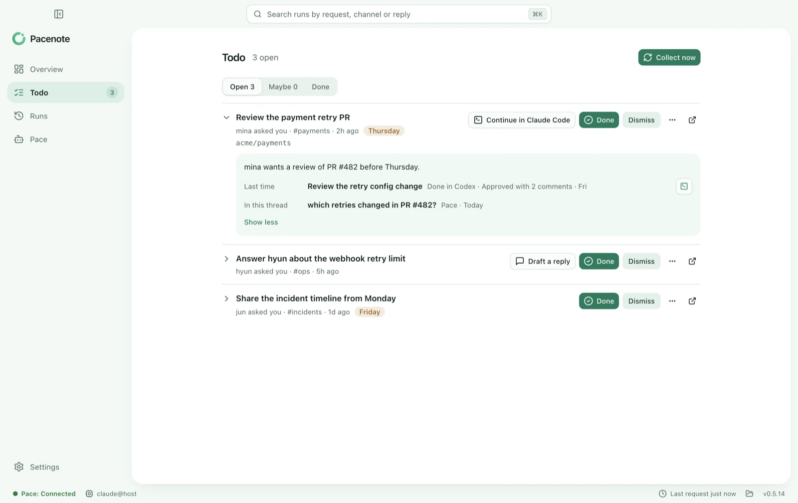
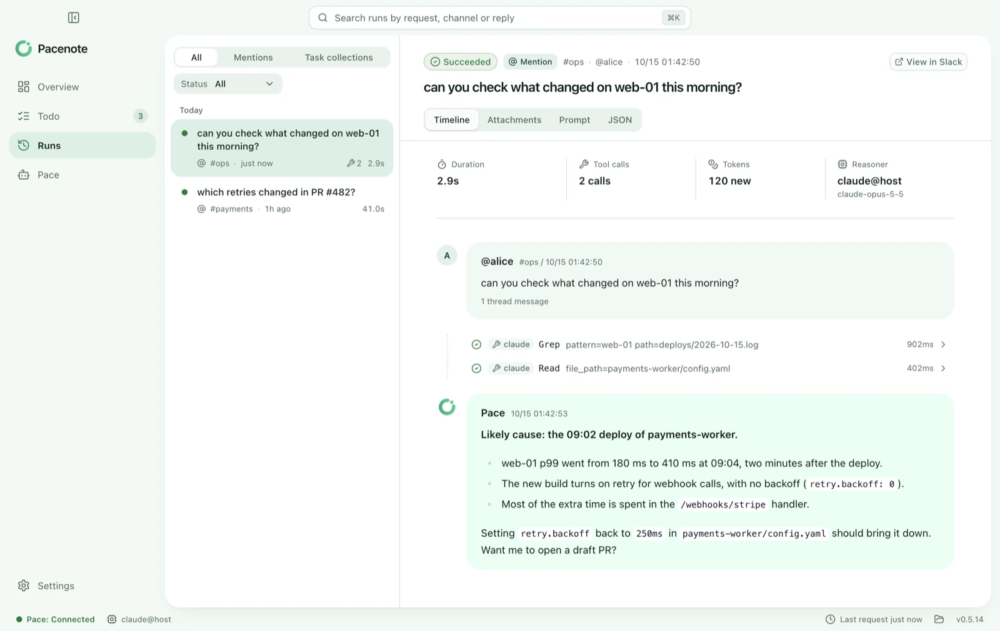

<p align="center">
  
</p>

<h1 align="center">Pacenote</h1>

<p align="center">
  <b>Everything asked of you, in one list on your Mac.</b><br>
  A free Mac app for developers whose work arrives in Slack and gets done in Claude Code, Codex or opencode.
</p>

<p align="center">
  <a href="#install">Install</a> ·
  <a href="https://pacenote.dev">pacenote.dev</a> ·
  <a href="https://pacenote.dev/ko/">한국어</a> ·
  <a href="https://github.com/Ashon/pacenote/issues/new?template=design-partner.yml">Become a design partner</a>
</p>

<p align="center">
  <a href="https://github.com/Ashon/pacenote/actions/workflows/ci.yml"></a>
  <a href="https://github.com/Ashon/pacenote/actions/workflows/ci.yml"></a>
</p>

<p align="center">
<picture>
  <source media="(prefers-color-scheme: dark)" srcset="docs/images/todo-dark.webp">
  
</picture>
</p>

Pacenote gathers what people ask of you in Slack, read through your AI tool's own Slack connector, and what your Claude
Code, Codex or opencode sessions leave for later. Each task keeps its history, and when you pick one up, Pacenote opens
the session with the thread and how related work ended last time, even when that work was done in another tool.

**Pace**, the assistant you mention in Slack, is optional: turn it on and it answers you there, from your Mac, with the
Claude Code or Codex you are signed in to, on the subscription you already have.

Everything stays in `~/.pacenote` on your Mac, and Pacenote sends no telemetry. In rallying, the co-driver reads the
pace notes so the driver can keep their eyes on the road. You drive; Pace reads the notes.

## What you can do

### Keep track of what is asked of you

**Collect now** has Claude Code (through your claude.ai Slack connector) or Codex (through ChatGPT's Slack app) read
Slack, read only, and lists what people asked of you and what you said you would do: by your @mention, the other names
people call you, or a user group that means you. Anything it is not sure about waits under Maybe instead of cluttering
the list, a Maybe from a group asks once whether that group means you, and a message never becomes a task twice. With
both on your Mac, the other one takes over when the one you chose is at its usage limit.

**New task** (⌘N) adds one of your own, in the project its words point to. A task can be in progress (you mark it, or a
session worked on it in the last day) or waiting on someone else until something new comes in its thread, and Today,
above the list, names the ask waiting on you, the task to pick up and the one waiting longest on someone else.

### Pick up where you left off, in either tool

**Continue in Claude Code** (or Codex) opens a session in your terminal, or in the Claude app or the Codex app, with the
task, the thread, what Pace found there, and how related work ended last time, even when that work was done in the other
tool. When the session is done, it closes the task with a note on how it ended and, if someone is waiting on you, a
reply for you to send. A session you start yourself in a repository is told its open tasks from the start, and Todo
shows the work as it happens.

<p align="center">
<picture>
  <source media="(prefers-color-scheme: dark)" srcset="docs/diagrams/trajectory-dark.svg">
  
</picture>
</p>

### Ask Pace in Slack, if you want it

Turn Pace on from the first run or Settings > General, then mention `@Pace` in a thread. Pace reads the thread and its
files (text, images, PDFs), works the question out with the `claude` or `codex` CLI you are signed in to, and answers in
the thread. The app keeps every run with each step Pace took, so you can see how it got there. In the built-in sandbox,
diagrams and charts in an answer come back as images, and Pace can use your Todo: ask it to keep what a thread needs
from you, list or close your tasks, or recap your week.

<p align="center">
<picture>
  <source media="(prefers-color-scheme: dark)" srcset="docs/images/run-dark.webp">
  
</picture>
</p>

### See where you contribute

**You** gathers your tasks and your Claude Code and Codex sessions into the areas you work in, such as a service's
repositories with the channel that asks about them, and shows how you contribute to each, what is open there and what
you did lately. Pacenote finds them on its own and shows them to you once; you only fix what it got wrong.

### Recap your day, week and month

**Recap** reads the same work at three distances: a day as a standup, a week by area with what carries over, a month by
where it went. It counts your tasks and your own commits as they are, has your AI (Claude Code, Codex, or opencode with
a model of your own) write it up in a few sentences only when you ask, and copies it as a standup or an update for you
to post.

### Move between your Macs

With Pacenote on two Macs, Todo is the same on both, merged directly over your network with no server in between. Pair
them once with no Slack app: Add a device on one, then From your other Mac in the other's first run (or Pair in its
Settings > Devices). With your own Slack app, Pace answers on the one you're using and moves with you when you leave it
for the other; Macs with the same Slack app find each other with nothing to pair. See [Your Macs](docs/macs.md). Coming
soon: iPhone and iPad, paired over your network the same way.

### Share the history with your AI tools

Pacenote's MCP server lets Claude Code, Codex, opencode and other MCP clients on your Mac read what Pace did, what is on your list
and where you contribute. You add it to each tool with one click, and only if you want to.

## What Pace never does

- **Answer anyone but you.** It runs with your login, so anyone else who mentions it gets a note only they can see.
  Teammates each run their own Pace through a [team hub](docs/team-hub.md).
- **Answer in private channels or DMs.** It works in public channels it has been invited to.
- **Send messages for you.** It answers in the thread you asked in; replies it drafts for your tasks are yours to send.
- **Change your files.** On your Mac, the CLI gets read-only access to one folder you choose, and never your
  credential folders. In the built-in sandbox, each answer runs in a Linux VM that is thrown away afterwards and reaches
  only the domains you allow. With GitHub's Write on, Pace edits only its own copy of a repository and opens a draft PR
  from a `pacenote/` branch; your working copy is left as it is.
- **Give your credentials to the model.** Slack and hub tokens never reach the CLI. With connections on in Settings >
  Tools, SSH keys and cluster, GitHub and Jira tokens stay in a separate broker, which the model asks for read-only
  lookups and, only where you turn on Write, draft PRs and Jira issues or comments.
- **Open a public endpoint or phone home.** It connects to Slack over Socket Mode, so nothing listens for the internet:
  only your other Macs reach it, on your own network: ones you paired or set up with the same Slack app, or a new one
  while Add a device waits.
  Besides Slack (or your hub), your AI
  service and the services you connect in Settings > Tools, it talks only to GitHub to check for updates, and downloads the
  sandbox's images when you set it up. There is no telemetry.
- **Bill you or hold your AI account.** Answers use the subscription you already have, through its official CLI.

How each of these is enforced is in [Reasoner sandbox](docs/sandbox.md), [Tools](docs/ops-tools.md) and
[How it works](docs/how-it-works.md).

## Requirements

- A Mac with Apple silicon and macOS 12 or later. The built-in sandbox needs macOS 15 or later.
- Claude Code with a Claude Pro, Max, Team or Enterprise plan, or Codex 0.138 or later with ChatGPT Plus, Pro or
  Business, signed in on that Mac.
- To gather asks from Slack: Claude Code, with the Slack connector of your claude.ai account, or Codex, with ChatGPT's
  Slack app.
- For Pace, the optional Slack assistant: a Slack workspace where you can create an app, or your team's Pacenote hub.

## Install

```sh
brew tap ashon/tap
brew trust ashon/tap
brew install --cask pacenote
```

Homebrew loads casks only from taps you trust, so without `brew trust` the install is refused and upgrades skip
Pacenote.

Open Pacenote. A first run asks for your AI, shows where your work is read from (this Mac, then Slack through your AI
tool's connector) and collects your last 7 days, then opens Todo. There is no Slack app to make. For Pace, choose **Set
up Pace** on the first run or in Settings > General: its setup takes you through where answers run, Slack and a review,
and ends when Pace answers you in Slack for the first time.

`brew upgrade --cask pacenote` updates the app. Settings and run history live in `~/.pacenote` and are kept across
upgrades and uninstalls. To run from source instead, see [Installation](docs/installation.md).

## How it works

<p align="center">
<picture>
  <source media="(prefers-color-scheme: dark)" srcset="docs/diagrams/architecture-dark.svg">
  
</picture>
</p>

1. A mention reaches Pace on your Mac over Socket Mode, or through your team's hub.
2. Pace checks that it is you asking, in a public channel, then reads the thread and its files.
3. It runs `claude` or `codex` on your Mac, limited to one folder, or in the built-in sandbox's VM.
4. It takes its own secrets out of the answer, replies in the thread, and records every step in the run history.

The design, one mention end to end, and the code layout are drawn in [Architecture](docs/architecture.md).

## For teams

A team can share one Slack app through a Pacenote hub. Each member pairs their own Mac once, from a link a paired
teammate shares or with the hub's address, and the hub sends each mention to the desktop of the person who wrote it, where Pace answers with that person's login, sandbox and tools. The
Slack tokens stay on the hub. See [Team hub](docs/team-hub.md).

## Documentation

| Doc | What it covers |
| --- | --- |
| [Architecture](docs/architecture.md) | The design in seven diagrams: the pieces, one mention, your tasks and AI tools, a task's trajectory, the team hub, the layers, the code layout |
| [How it works](docs/how-it-works.md) | The path from a mention to its answer, attachments, diagrams and images, the reasoner CLIs |
| [Reasoner sandbox](docs/sandbox.md) | Where answers run: on your Mac and what the CLI may read there, or the built-in VM sandbox, its allowed domains and login |
| [Tools](docs/ops-tools.md) | Connections Pace reads (hosts, k8s, a work folder, GitHub, Jira) and, where you turn on Write, draft PRs and Jira issues |
| [Team hub](docs/team-hub.md) | One Slack app for a team, with each member's desktop answering their own mentions |
| [Your Macs](docs/macs.md) | Pace answering on the Mac you're using, Todo the same on each, and how the Macs know each other |
| [Your tasks from Slack](docs/tasks.md) | What people ask of you, collected on the Todo screen, and continuing it in Claude Code, Codex or opencode |
| [Run history for AI tools](docs/history-mcp.md) | Pacenote's MCP server: your AI tools reading what Pace did and your tasks |
| [Installation](docs/installation.md) | Homebrew in detail, running from source, restarts and the run lock |
| [Desktop app](docs/desktop-app.md) | The app's screens, setup, settings, sandbox controls, packaging |
| [Development](docs/development.md) | Checks, end-to-end tests and coverage, adding a messenger |
| [Releases](docs/releases) | Release notes |

## Development

```sh
pnpm install
pnpm check      # typecheck, lint, format, unit tests
pnpm test:e2e   # the bot and the hub against a local Slack stand-in
pnpm desktop    # the desktop app from source
```

See [Development](docs/development.md) for more.

## Names

**Pacenote** is the app and the project. **Pace** is who you talk to: the assistant in Slack and the voice of the app.

## License

Pacenote is a personal project, maintained by one person and offered as is. It is licensed under the
[Apache License 2.0](LICENSE). The app and the hub's image carry the licenses of the software they bundle
(THIRD-PARTY-NOTICES.txt), and the sandbox's Linux kernel is GPL-2.0, with its source described in
[Reasoner sandbox](docs/sandbox.md#the-kernels-source).
