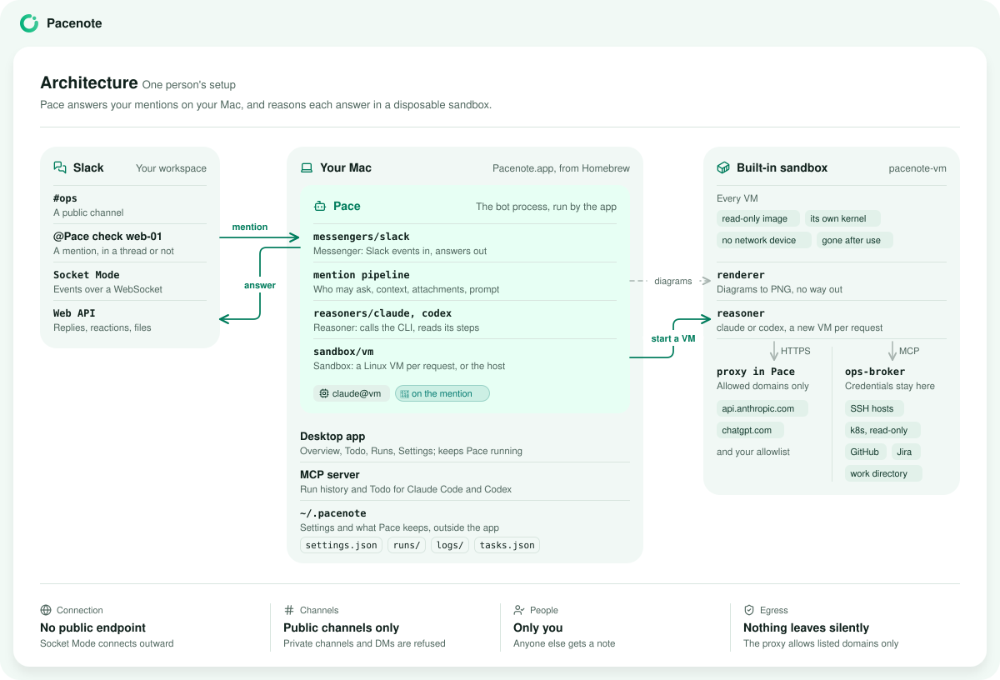
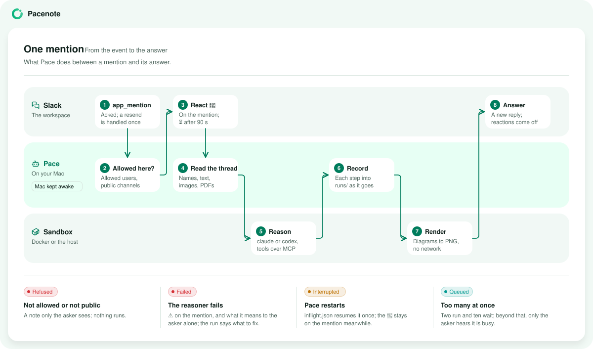
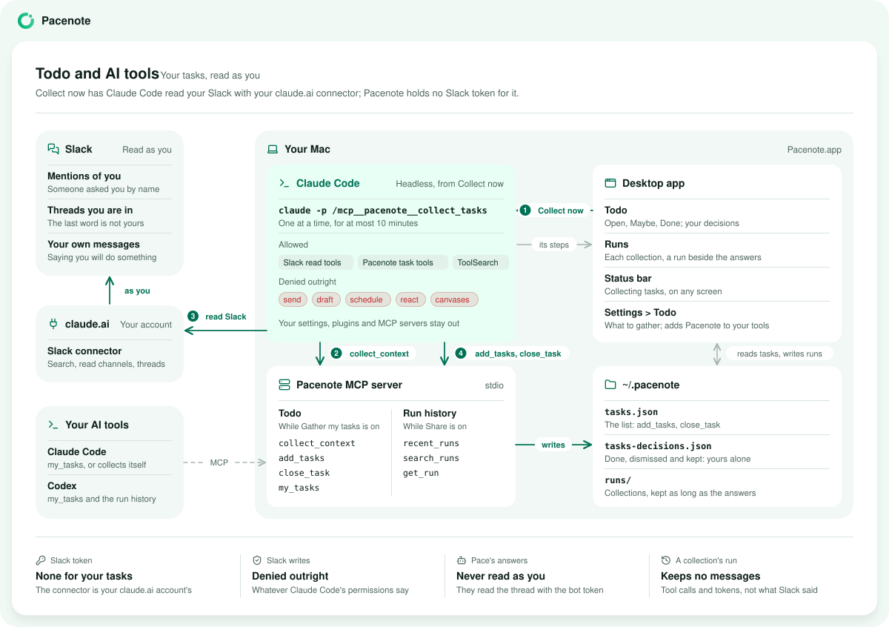
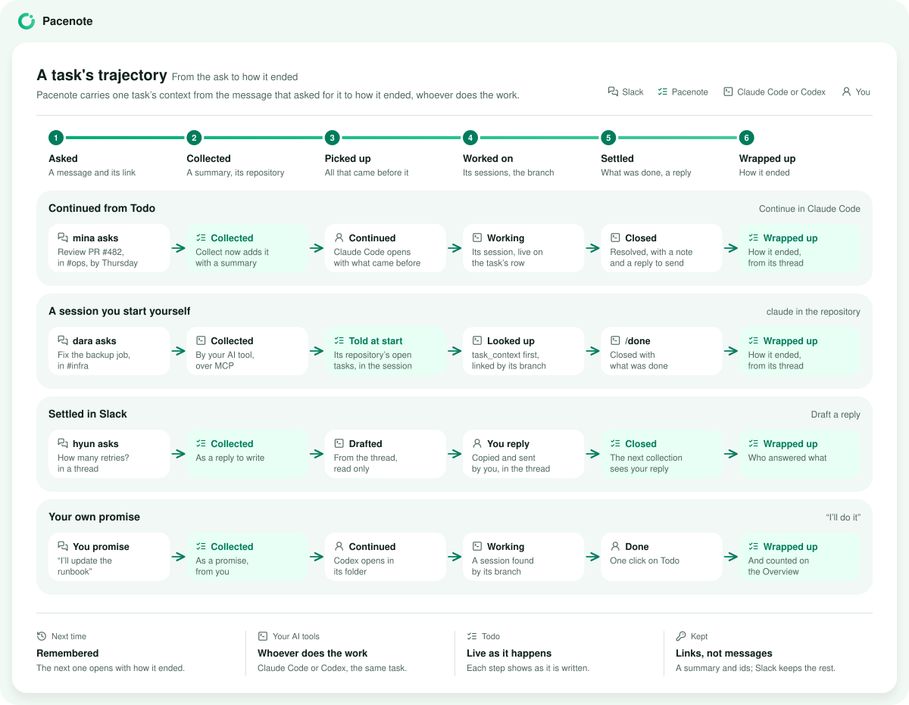
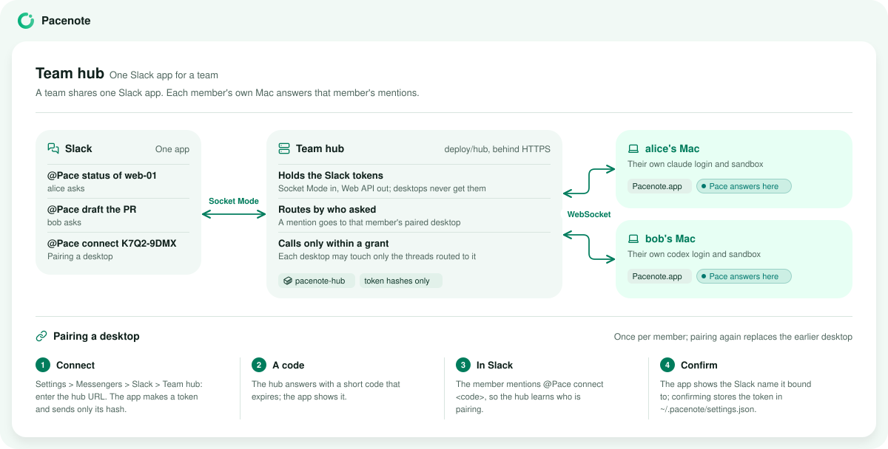
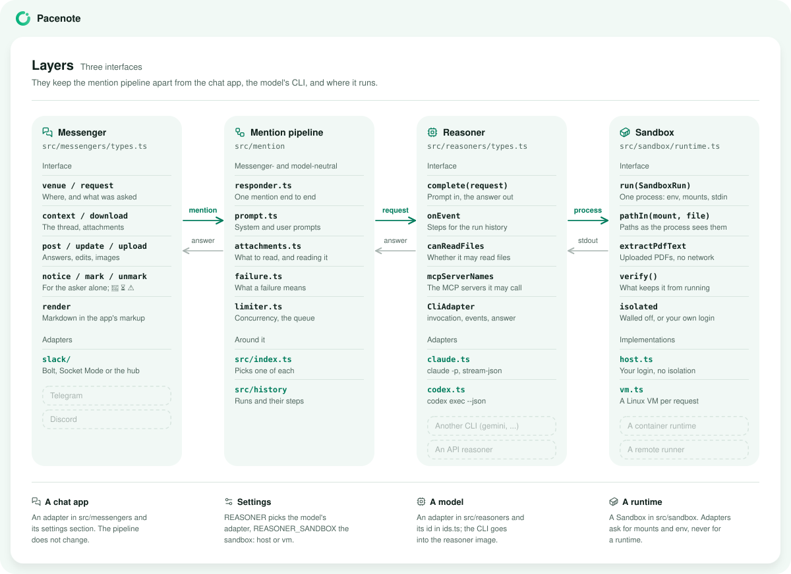
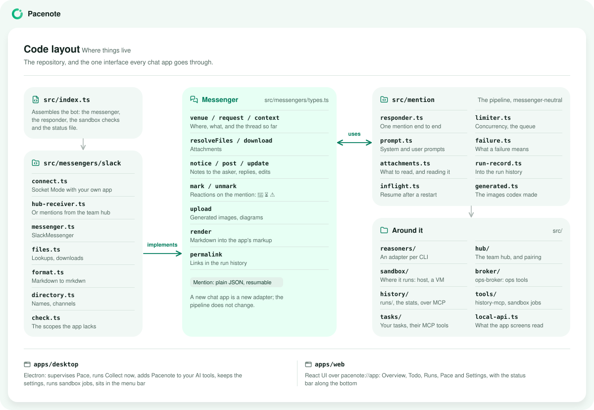

# Architecture

How Pacenote is put together, in seven pictures. The diagrams are drawn by `scripts/diagrams.mjs`
(`pnpm docs:diagrams`) in the desktop app's look, with a light and a dark variant; the colors and icons are read from the
app, so drawing them again keeps them in step with it.

## The pieces

Pace, the bot, runs on your Mac as a process the desktop app manages, in four layers: the Slack messenger, the
mention pipeline, the reasoner that calls your `claude` or `codex` CLI, and the sandbox the CLI runs in. Slack reaches
it over Socket Mode, so nothing listens on a public port. With the built-in sandbox, each answer is reasoned in a new
Linux VM of its own, started by the app with no network device, whose only ways out are Pace's own egress proxy (the
model APIs and the domains you allow) and ops-broker (ops tools, in a VM of its own that keeps the credentials).
Without it, the CLI runs on your Mac with your own login.
Diagrams are rendered in a VM of their own, with no way out. The app also offers an MCP server to the AI tools
on your Mac, for your tasks and the run history ([below](#your-tasks-and-ai-tools)). Settings and everything Pace keeps
live in `~/.pacenote`.

<picture>
  <source media="(prefers-color-scheme: dark)" srcset="diagrams/architecture-dark.svg">
  
</picture>

More: [How it works](how-it-works.md), [Reasoner sandbox](sandbox.md), [Ops tools](ops-tools.md),
[Desktop app](desktop-app.md).

## One mention

A mention is checked (that it is you, in a public channel), marked with 👀 at once (and ⏳ after 90 seconds), and
reasoned with the thread and its attachments as context, while the app keeps the Mac awake. Each step goes into the run
history as it happens, diagram blocks are rendered, and the answer comes as a new reply. A restart resumes an unfinished
answer once, with the 👀 still on the mention, and never posts an answer twice.

<picture>
  <source media="(prefers-color-scheme: dark)" srcset="diagrams/mention-flow-dark.svg">
  
</picture>

## Your tasks and AI tools

Todo keeps what people ask of you in Slack. **Collect now** has Claude Code or Codex, headless, read your Slack with the
Slack connector of your claude.ai account or ChatGPT's Slack app, read only, and add the tasks through Pacenote's MCP
server (the other one takes over when the one chosen cannot, [below](tasks.md#which-ai-does-the-work)): Pacenote holds no Slack
token for your tasks, and Pace's answers never read as you. Each collection is a run in the run history, with its tool
calls and tokens but not what Slack returned. The same server, started by Claude Code or Codex over stdio, gives them
your tasks and, while you share it, the run history.

<picture>
  <source media="(prefers-color-scheme: dark)" srcset="diagrams/todo-dark.svg">
  
</picture>

More: [Your tasks from Slack](tasks.md), [Run history for AI tools](history-mcp.md).

## A task's trajectory

A task keeps its context from the message that asked for it to how it ended, whoever does the work. Collected, it has
the message's link, a summary and its repository. Picked up, from Todo or in a session you start in the repository,
which Pacenote tells its open tasks, it brings what came before: earlier tasks in the thread, the repository and from
the same person, and Pace's answers. Worked on, its sessions join its work log and Todo shows them as they go. Settled
by the session, by your reply in Slack or by you, it says what was done; the next collection wraps it up from its
thread, and the next task like it opens with that.

<picture>
  <source media="(prefers-color-scheme: dark)" srcset="diagrams/trajectory-dark.svg">
  
</picture>

## Team hub

For a team, one hub server holds the Slack app and routes each member's mentions to that member's own desktop, which
answers with that member's login, sandbox and tools. Desktops pair once with a code sent to Pace in Slack and never
hold a Slack token.

<picture>
  <source media="(prefers-color-scheme: dark)" srcset="diagrams/team-hub-dark.svg">
  
</picture>

More: [Team hub](team-hub.md).

## Your Macs

With Pacenote on more than one Mac and your own Slack app, the Macs find each other (Bonjour, or an address you add)
and talk over a channel only they can open, keyed by the Slack app token they share (`src/macs/channel.ts`). One of
them holds Pace's Slack connection: each claims a lease when the rules say so, the one you're using after you leave
the other, and all settle on the latest claim (`lease.ts`, `macs.ts`). The desktop app tells its Pace to open or close
its connection, and Pace keeps running either way. Your Todo files are merged between them as they change
(`sync.ts`, `todo-sync.ts`); sessions and run history stay on their Mac.

More: [Your Macs](macs.md).

## Layers

Three interfaces keep the mention pipeline apart from everything it could be swapped for:

- **Messenger** (`src/messengers/types.ts`): the chat app. Mentions come in through it, and answers, edits, images,
  reactions on the mention and notes for the asker alone go out. Slack is the adapter today.
- **Reasoner** (`src/reasoners/types.ts`): the model. The pipeline asks for one answer and gets progress steps along
  the way. Each CLI is a `CliAdapter` (`claude.ts`, `codex.ts`) that says how to call it, what it may read, and how to
  read what it prints; one runner (`cli.ts`) runs any adapter.
- **Sandbox** (`src/sandbox/runtime.ts`): where the CLI runs. A sandbox runs one process with the environment values,
  mounts and working directory it is given, and knows nothing about which CLI it is. `host.ts` runs it on your Mac with
  your login; `vm.ts` runs it in a disposable Linux VM of its own. An isolated sandbox puts mounts at fixed paths
  (`SANDBOX_PATHS`: `/workspace`, `/attachments`, `/out`, `/run/secrets`) that the reasoner image is built for.

`src/index.ts` builds one of each from the settings. The dashed slots are where the next ones go.

<picture>
  <source media="(prefers-color-scheme: dark)" srcset="diagrams/layers-dark.svg">
  
</picture>

## Code layout

The mention pipeline (`src/mention`) talks to chat apps only through the `Messenger` interface
(`src/messengers/types.ts`); Slack is its first adapter. Models are reached through `src/reasoners` and run in
`src/sandbox`, as above. Your tasks (`src/tasks`) and the run history (`src/history`) are offered to AI tools by the MCP
server in `src/tools/history-mcp.ts`.

<picture>
  <source media="(prefers-color-scheme: dark)" srcset="diagrams/code-layout-dark.svg">
  
</picture>

More: [Development](development.md), including how to add a messenger, a reasoner or a sandbox.
